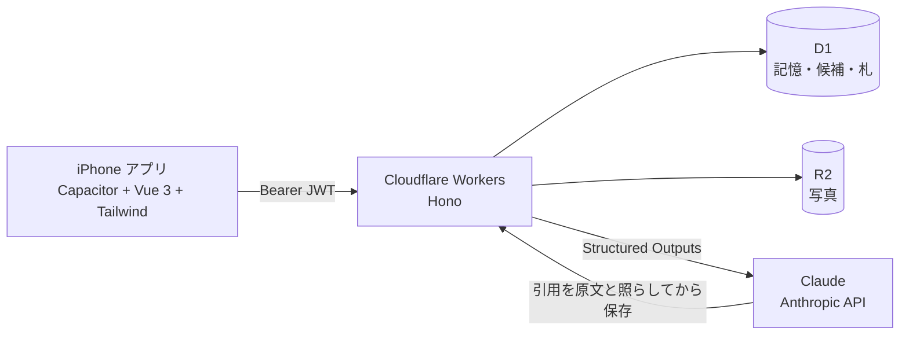

# そういえば。

ひとことと写真 1 枚を残しておくと、あとで新しいひとことを書いたとき、関係のある昔の記憶が、そのときの言葉のまま「そういえば。」と浮かんでくる iPhone アプリです。

Built with Claude: Japan 2026 ハッカソンの個人開発（開発期間 2026-11-03〜11-08）。

- デモ動画（3 分）: 【要記入: デモ動画の URL】
- 選んだテーマ: 【要記入: テーマ 1 か 2】
- 提出物と審査の観点: [docs/submission.md](docs/submission.md)

| 書く | そういえば。 | つながり |
|---|---|---|
| 【スクリーンショット: 書く画面】 | 【スクリーンショット: 札】 | 【スクリーンショット: つながり】 |

> **In English** — *Souieba* ("Oh, that reminds me.") is an iPhone app for keeping one line and one photo about your day.
> When you write something new, Claude reads your own past entries and brings back at most three that are truly related, each with the reason and a verbatim quote of what you wrote back then.
> The Worker checks every quote against the original text before it is shown, and when nothing is related the app simply stays quiet.
> People, places, things and what appears in a photo ("cherry blossoms, maybe?") stay candidates until you tap 「そう」 (yes); nothing guessed is ever stored as a fact.
> Built in one week with Claude Code at the center: multi-agent workflows that compare designs and adversarially verify every review finding, the iOS Simulator MCP for builds and measurements, hooks that guard secrets and signing files, and project Skills for the steps we repeat.

## どんな困りごとから

【要記入: 開発者自身の体験。誰が、どんな場面で、どれくらい困っていたか（500 字の説明と動画の冒頭と同じ言葉で）】

写真も日記も、残すことはずいぶん簡単になりました。けれど読み返すきっかけが無いまま、大切な人との記憶は端末の奥で眠っていきます。
「そういえば。」は、今日のひとことを書くことそのものを、昔の記憶を呼び起こすきっかけにします。浮かんでくるのは、あなた自身がその日に書いた言葉です。

## できること

| | |
|---|---|
| **書く** | ひとことと写真 1 枚。日付は「いつ？」で、日・月・年のどれかでざっくり決められる（「2024 年の 6 月ごろ」でもいい） |
| **そういえば。** | 残すと、関係のある昔の記憶だけが、関係の理由と当時の原文の引用を添えて一筆箋で浮かぶ（最大 3 件、ふだんは 2〜4 秒）。関係が無ければ何も出ない |
| **候補は候補のまま** | 人・場所・もの・日付と、写真から見えたもの（「桜でしょうか」）は候補として出るだけ。「そう」と頷くまで、記憶にも次の「そういえば。」にも使わない。「ちがう」と言えばそれまで |
| **つながり** | 浮かんだ昔の記憶と今日のひとことが、ふたつの日として糸で結ばれる。昔の記憶の画面で「そうだった」と返すと本縫いになる。書きためるほど組が増えていく |
| **開きたくなる工夫** | 時間帯と季節で替わるあいさつと問いかけ、このごろ 7 日の押し葉、去年以前のいまごろの「あの日のひとこと」、季節で替わる押し葉と封蝋。続けた日数は数えない（途切れを責めない） |
| **iPhone の手ざわり** | 画面の移り変わり、左端からなぞって戻る、シートをなぞって閉じる、押した直後だけの触覚、鍵盤の上に残る「保存する」。「動きを減らす」の設定ではすべての動きを止める |

## 大切にしていること（変えない原則）

1. **推測を事実として確定しない。** 出てくるのはいつも「候補」で、決めるのはあなた
2. **関係なければ何も言わない。** 「そういえば。」が出ない日があっていい。0 件も正しい答え
3. **思い出すときは、必ず昔のひとことの原文を添える。** 原文に無い引用は捨てる
4. **創作しない。** 書いていない出来事を足さない
5. **記憶はあなたのもの。** 消せばすぐ消える。思い出すのに使うのは、あなた自身の記憶だけ

画面には「AI」という言葉を出しません。テクノロジーを意識させない、温かい記憶のアプリにしたかったからです（`scripts/check-words.mjs` が CI で見張っています）。

## Claude がいないと成り立たない所

- **思い出す（C1）・候補を出す（C2）・写真から候補を出す（C3）** は Claude（既定 `claude-opus-5-5`）。Worker から `@anthropic-ai/sdk` で呼ぶ
- 答えの形は Structured Outputs（`output_config.format`）の JSON Schema で固定する（[ADR-0005](docs/decisions/0005-structured-outputs-instead-of-forced-tool-choice.md)、[worker/src/ai/schemas.ts](worker/src/ai/schemas.ts)）。現行のモデルは強制の `tool_choice` を受け付けないため
- **Claude の答えをそのまま信じない。** Worker が引用を一字ずつ原文と照らし、本文に無い引用・その人のものでない記憶・自分自身を指す札・4 件目以降を捨てる。候補は値まで本文の言葉かを見る（[worker/src/ai/verify.ts](worker/src/ai/verify.ts)）
- 関係が無ければ空の配列を返してもらい、それを正しい答えとして何も保存しない。過去の記憶が無ければそもそも呼ばない
- 用途ごとに使い分ける: 候補は `effort: low`、想起は `effort: medium`。決まった指示は system に置いてプロンプトキャッシュに乗せる。20 秒で打ち切り、失敗は静かに何も出さない（理由は `ai_runs` に残す）

## Claude Code でどう作ったか

7 日間、Claude Code を開発の真ん中に置きました。仕様書の組み直しから、設計の判断、実装、テスト、iPhone 実機への入れ込みまでです。目的ごとに道具を分けています（数字は 11/7 時点。棚卸しの根拠は [docs/submission.md](docs/submission.md)）。

| 目的 | 使ったもの | 跡 |
|---|---|---|
| 判断を残す | ADR | [docs/decisions/](docs/decisions/) に 12 本。試して戻した判断（iOS 標準の見た目、ADR-0008）も残している |
| 案を比べて選ぶ | ワークフロー（複数のサブエージェント） | 見た目（便箋 / 日記 / 静けさ）とつながり画面（糸 / ふたつの日 / 星座）を、それぞれ 3 体が並行で 402pt の見本にし、開発者が選んだ（ADR-0010、ADR-0009） |
| 見直す | 見つける役と反証する役を分けたワークフロー | 見直し 4 回。見つける役 26 体の指摘を、別の 148 体が反証してから直した。反証された指摘は直していない（ADR-0011 の 11・12 節） |
| 手分けして作る | ワークフロー | iPhone 向けの作り込みを 5 つの受け持ちに分け、5 体が並行で作った（ADR-0011） |
| 実機と Simulator で確かめる | iOS Simulator の MCP、組み込みブラウザ | ビルド・起動・写し・タップ。鍵盤の高さ（404pt）や「保存する」の位置を測りながら作った（ADR-0011 の 4 節） |
| 秘密と署名ファイルを守る | フック | `.claude/hooks/guard-writes.mjs` が `.dev.vars`・デモの写真・署名ファイルへの書き込みを拒む。回帰テスト 39 件（`pnpm check:hook`） |
| 画面の言葉を守る | 見張りのスクリプトと CI | 「AI」「生成」「送信」と色の直書きを CI で止める（`pnpm check:words`、[.github/workflows/ci.yml](.github/workflows/ci.yml)） |
| くり返す手順をまとめる | プロジェクトの Skills | 実機への入れ込み・デモの DB の戻し・提出用の履歴づくり（[.claude/skills/](.claude/skills/)。11/7 に足した） |

## 期間中に作ったもの

このリポジトリの履歴は、2026-11-03 の「そういえば。」の最初のコミットから始まります。中身はすべて開発期間中に書きました。
以前の作業場所にあった別作品のコードは使っていません（[ADR-0002](docs/decisions/0002-replace-yui-codebase.md)。引き継いだのは `.editorconfig`・`.gitignore`・`LICENSE` の設定ファイルだけ）。
画面の決めごとと見直しの記録は [docs/wireframes.md](docs/wireframes.md) にあります。

## あなたの記憶の扱い

- 書いた記憶と写真を見られるのは、書いた本人だけ（API はログインした人の記憶しか返さない）
- 思い出すとき・候補を出すときに、本文と起きた日、同じ人の過去の記憶（新しい順に 200 件まで。本文・起きた日・頷いた候補）を Anthropic の Claude API に渡す。写真を添えたときは、写真から候補を出すために写真も渡す（人を見分けることはしない）
- Anthropic は、API の入出力を既定ではモデルの学習に使わない（[Anthropic のヘルプ](https://privacy.claude.com/en/articles/7996868-is-my-data-used-for-model-training)）。保持の扱いは [API のデータ保持](https://docs.anthropic.com/en/docs/build-with-claude/zero-data-retention) を参照
- 記憶は 1 件ずつ、すぐに消せる（写真と、その記憶につながった「そういえば。」も一緒に消える）。全部消したいときは開発者に連絡すれば、D1 と R2 から消す（手順は [docs/setup-cloudflare.md](docs/setup-cloudflare.md)）

## 審査員の方へ: 試し方

iPhone のアプリは開発者の Mac から直接入れているので、手元の iPhone では動かせません。

1. デモ動画（3 分）を見る
2. ブラウザで試す: 下の「動かし方」で `pnpm preview`（http://localhost:8787）を開き、招待コード `dev` と `demo@example.com` で入る。デモの過去の記憶は `pnpm db:seed:local` で入る。`.dev.vars` に `ANTHROPIC_API_KEY` が要る（無いと札は出ない）。「スーパーで青梅を見かけた」と書くと、2024 年のおばあちゃんの梅干しの記憶が浮かぶ
3. iPhone で試す: [docs/setup-capacitor.md](docs/setup-capacitor.md)（Mac と Xcode が要る）

## いまの制約

- 相手は iPhone だけ（[ADR-0011](docs/decisions/0011-iphone-first.md)）。Android はビルドが通ることだけ確かめていて、見た目や手ざわりは合わせていない
- 招待制で、アプリは開発者が直接入れる（App Store・TestFlight には出していない）。ログアウトと設定の画面は無い（トークンは 90 日で切れる）
- ふりかえり（人や期間を軸にした語り、C4）は作っていない

## ハッカソンのあと

【要記入: 誰が、どんな場面で使い続けるか】

渡し方: 招待コードを本人に直接渡し、アプリは開発者が入れる。やめたいとき・全部消したいときは開発者に連絡する。

## 仕組み



- ログインは招待コードとメールアドレス（パスワードは無い）。Worker が 90 日有効のトークン（HS256 JWT）を返し、アプリが端末に保持する（[ADR-0007](docs/decisions/0007-capacitor-and-invite-jwt.md)）
- 画面は Capacitor の WebView で動く。Workers Static Assets から同じ画面を配信できるが、これはブラウザでの開発プレビュー用

## ドキュメント

読む順のおすすめ: [docs/demo-video.md](docs/demo-video.md) → [ADR-0011](docs/decisions/0011-iphone-first.md)・[ADR-0010](docs/decisions/0010-letter-design.md)・[ADR-0009](docs/decisions/0009-connections-screen.md) → [docs/spec.md](docs/spec.md) → [docs/architecture.md](docs/architecture.md)

| ファイル | 内容 |
|---|---|
| docs/spec.md | 仕様書 |
| docs/requirements.md | 機能要件と受け入れ条件 |
| docs/architecture.md | アーキテクチャ、データモデル、デザイン基盤 |
| docs/wireframes.md | 主要画面のワイヤーフレームと見直しの記録 |
| docs/tasks.md | 実装タスク一覧 |
| docs/setup-cloudflare.md | Cloudflare（D1 / R2 / secret / deploy）の手順 |
| docs/setup-capacitor.md | iOS / Android アプリのビルドと確認の手順 |
| docs/decisions/ | 判断の記録（ADR） |
| docs/submission.md | 提出物と審査の観点 |
| docs/demo-video.md | デモ動画の構成 |
| demo/fixtures/ | デモ 4 シナリオのフィクスチャ |

## 素材とライセンス

- 字体: Zen Maru Gothic・Noto Sans JP・Zen Old Mincho（Google Fonts、SIL Open Font License 1.1）。起動画面の「そういえば。」は Zen Maru Gothic で描いた画像
- アイコン（封蝋）・起動画面・押し葉と封蝋の模様・画面の線画は、この期間に自分で描いた（SVG を headless Chrome で PNG にした）
- Android のアイコンは Capacitor の既定のまま。`ios/`・`android/` の生成されたファイルは Capacitor と各ツールのもの

## 動かし方（開発者向け）

```sh
pnpm install
cp .dev.vars.example .dev.vars   # ANTHROPIC_API_KEY を手で書く（git には入れない）
pnpm db:migrate:local
pnpm dev:worker                  # Worker: http://localhost:8787
pnpm dev                         # 画面:   http://localhost:5173（/api は 8787 に中継）
```

ローカルの Worker は development として起動し、`X-Dev-User` ヘッダをログイン相当として受け付けます。
画面の開発サーバがこのヘッダ（既定は `X-Dev-User: dev@example.com`）を自動で付けるので、ブラウザではログイン画面を通らずに使えます（`DEV_USER=<メールアドレス> pnpm dev` で変更）。本番ではこのヘッダは無視されます。

ローカルの Worker には開発専用の招待コード `dev` が入っています（`pnpm dev:worker` が渡す既定値。`.dev.vars` に `INVITE_CODE` / `JWT_SECRET` を書けばそちらが優先）。
`pnpm preview`（画面を Worker から配信する本番と同じ形、http://localhost:8787）で開くと、ログイン画面に `dev` と好きなメールアドレスを入れて中に入れます（`=` の無い招待コードをどのメールでも受け付けるのは development だけ）。

### デモの状態で見る

既定の `dev@example.com` は記憶 0 件から始まります。想起は過去の記憶があるときだけ動くので、最初の 1 件では「そういえば。」は出ません。
デモ用の過去の記憶（`demo@example.com` の 16 件、2024〜2026）を入れて、そのユーザーで開きます。

```sh
pnpm db:migrate:local
pnpm db:seed:local                   # demo@example.com と other@example.com の D1 の行を消してから入れ直す
pnpm dev:worker
DEV_USER=demo@example.com pnpm dev   # fish なら env DEV_USER=demo@example.com pnpm dev
```

`pnpm preview` で開くときは、ログイン画面に招待コード `dev` とメールアドレス `demo@example.com` を入れます。
新しいひとことに「スーパーで青梅を見かけた」と書くと、2024 年のおばあちゃんの梅干しの記憶が札で出るはずです（`.dev.vars` の `ANTHROPIC_API_KEY` が要ります。札が出るか、その文面はモデルの出力しだい）。4 つのシナリオと seed の中身は demo/fixtures/README.md を参照。
seed は流すたびに `demo@example.com` と `other@example.com` の記憶を消して入れ直します。ふだんの作業は既定の `dev@example.com` のままにしてください。

### ログイン

本番では、招待コードとメールアドレスをアプリのログイン画面に入れます。招待コードは 1 人 1 つで、開発者がそのコードに結びつけたメールアドレスでしか入れません（`INVITE_CODE` は `コード=メール[,コード=メール…]` の対応表。docs/setup-cloudflare.md 4.1）。
Worker が 90 日有効のトークンを返し、アプリはそれを端末に保持して以降の呼び出しに付けます。トークンが切れたり無効になったりしたら、静かにログイン画面に戻ります。
招待コードは、その人のぶんだけを本人に直接伝えます。リポジトリや文書には書きません。

### アプリ（iOS / Android）

docs/setup-capacitor.md を参照。Mac で Xcode / Android Studio を使います。

```sh
printf 'VITE_API_BASE=%s\n' https://<api-domain> > web/.env.production   # アプリが叩く Worker の URL（git には入れない）
pnpm cap:sync        # 画面をビルドして ios/ と android/ に同期
pnpm cap:ios         # 同期して Xcode を開く
pnpm cap:android     # 同期して Android Studio を開く
```

### デプロイ

docs/setup-cloudflare.md を参照。

```sh
pnpm exec wrangler secret put ANTHROPIC_API_KEY
pnpm exec wrangler secret put INVITE_CODE     # コード=メール を人ごとに , でつなぐ（コードは openssl rand -hex 8）
pnpm exec wrangler secret put JWT_SECRET      # 32 文字以上（openssl rand -base64 48）
pnpm db:migrate:remote
pnpm run deploy     # pnpm deploy は pnpm 組み込みコマンドと衝突するため run を付ける
```

## ライセンス

MIT
